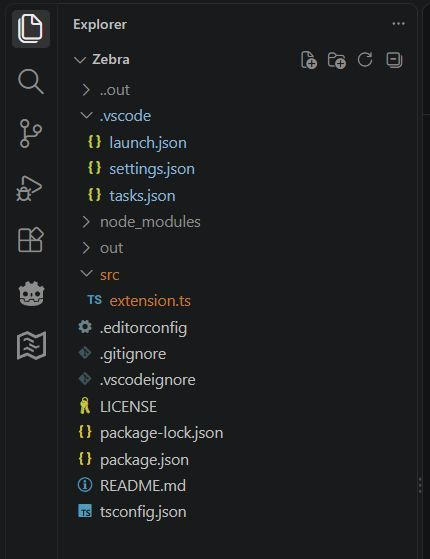

# Zebra

This extension lets you assign colors to folders by name or by workspace-relative path. Files and sub-folders inside a matched folder inherit its color.



## Features

- Assign a color to a folder by name, wherever it appears in the workspace
- Target a specific folder using its workspace-relative path
- Apply a folder's color to all of its descendants
- Use hexadecimal colors or a reusable manual color palette
- Give more specific paths priority over folder-name matches
- Update decorations when the configuration changes
- Apply file colors to their corresponding editor tabs
- Adds a **Copy Filename** command to the Explorer and editor tab context menus, including folders ([vsCode issue #301362](https://github.com/microsoft/vscode/issues/301362), *"Closed as not planned"*)

## Configuration

Add a `zebra.colors` object to your vsCode settings. Each property maps a folder name or workspace-relative path to a color.

### Automatic colors

Use a six-digit hexadecimal color. Zebra assigns it to an available automatic color slot and manages the corresponding `workbench.colorCustomizations` entry.

```json
{
    "zebra.colors": {
        ".vscode": "#4682B4",
        "node_modules/.bin": "#718C28",
        "src": "#C17A36"
    }
}
```

A folder-name rule such as `src` matches folders with that name anywhere in the workspace. A path rule such as `node_modules/.bin` targets that path relative to the workspace root and its descendants.

When multiple rules match, the most specific path rule takes priority over a folder-name rule.

Zebra supports up to 32 distinct automatic hexadecimal colors at a time. Repeated hexadecimal values share the same automatic slot.

### Manual palette colors

You can also reference one of Zebra's 32 contributed palette color IDs. Define the actual color in `workbench.colorCustomizations`.

```json
{
    "zebra.colors": {
        "src": "zebra.color17",
        "node_modules/.bin": "zebra.color3"
    },
    "workbench.colorCustomizations": {
        "zebra.color17": "#718C28",
        "zebra.color3": "#4682B4"
    }
}
```

Manual palette IDs range from `zebra.color1` through `zebra.color32`. Zebra does not assign or change their color values.

Automatic slots (`zebra.auto1` through `zebra.auto32`) are managed internally by Zebra; you do not need to reference them in `zebra.colors`.

## Path matching

- Use `/` to separate path components, for example `node_modules/.bin`.
- Paths are relative to the workspace folder.
- Matching is case-sensitive.
- A path rule matches the specified folder and everything below it.
- A folder-name rule matches that folder name wherever it occurs.
- A matching full path takes priority over a folder-name rule; among full paths, the longest match wins.

## Installation

Install Zebra from a VSIX package:

1. Open the Extensions view in vsCode (`Ctrl+Shift+X`).
2. Open the Extensions view's `...` menu.
3. Select **Install from VSIX...**.
4. Choose the Zebra `.vsix` file.

## Building from source

Requirements:

- Node.js and npm
- Visual Studio Code

From the project directory:

```cmd
npm.cmd install
npm.cmd run compile
npm.cmd exec -- vsce package
```

The generated `.vsix` file is written to the project directory. To choose another destination, use the `--out` option:

```cmd
npm.cmd exec -- vsce package --out "releases/zebra-0.1.0.vsix"
```

The destination directory must already exist.

To run the extension in a development host, open the project in vsCode and press `F5`.

## License

Zebra is released under the [MIT License](LICENSE).
